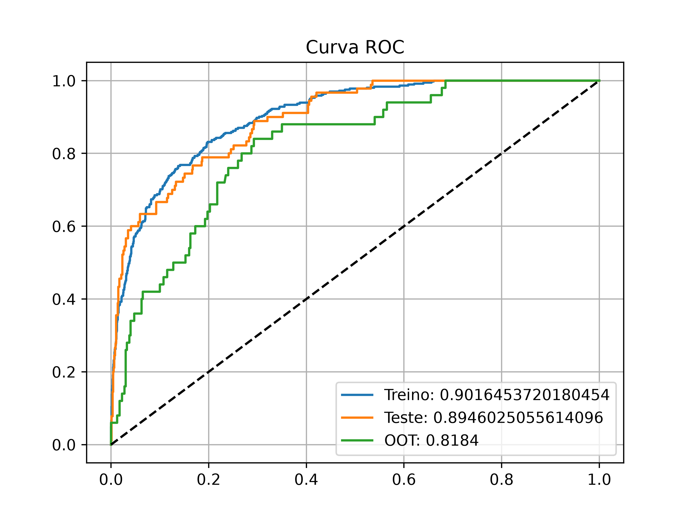

# Loyalty Predict

Modelo de machine learning que prevê quais clientes de um programa de fidelidade vão estar no ciclo de vida **Fiel** daqui a 28 dias. O projeto vai do dado bruto ao modelo registrado no MLflow: engenharia de dados em SQL, feature store com snapshots diários, treino com validação out-of-time e escoragem da base.

> Projeto desenvolvido acompanhando o [Loyalty Predict](https://github.com/TeoMeWhy/loyalty-predict) do [Téo Me Why](https://github.com/TeoMeWhy). Os dados são públicos e vêm do sistema de pontos e da plataforma de cursos da comunidade dele.

## Problema

Em um programa de fidelidade, saber **antes** quem vai virar (ou continuar) cliente fiel permite direcionar ações de engajamento para as pessoas certas. A pergunta do modelo é:

> Dado o comportamento de um cliente até a data de referência, qual a probabilidade de ele estar no ciclo de vida **02-FIEL** 28 dias depois?

## Resultados

| Base | Acurácia | AUC |
|---|---|---|
| Treino | 0.932 | 0.910 |
| Teste | 0.931 | 0.891 |
| Out-of-time (último mês) | 0.889 | 0.813 |



- A taxa de clientes fiéis na base é de **~8,7%**, então a acurácia sozinha engana (chutar "não fiel" para todos já acerta ~91%). A métrica principal é a **AUC**.
- A base **out-of-time** é o mês mais recente, separado antes do treino. A queda de AUC de 0.89 para 0.81 mostra o efeito da mudança de comportamento ao longo do tempo.
- Variáveis mais importantes: `qtdeFrequencia`, `avgFreqGrupo`, `pctAtivacaoMAU`, `qtdeAtivacaoD14` e `qtdePontosPosD7`.

## Arquitetura

```
data/loyalty-system ─┐                         ┌─ life_cycle ────────┐
                     ├─ exec_query.py + SQL ──>│  fs_transacional    ├─ target.sql ─> abt_fiel ─> train.py ─> MLflow (model_fiel) ─> predict.py
data/education-     ─┘   (snapshots diários)   │  fs_life_cycle      │
  platform                                     └─ fs_education ──────┘
```

1. **Ciclo de vida** ([life_cycle.sql](src/analytics/life_cycle.sql)): classifica cada cliente em cada data de referência pela recência e frequência de transações: `01-Curioso`, `02-Fiel`, `02-Reconquistado`, `02-Reborn`, `03-Turista`, `04-Desencantada`, `05-Zumbi`.
2. **Feature store** (`fs_*.sql`): três tabelas de atributos calculadas sempre com dados *anteriores* à data de referência, para não vazar informação do futuro:
   - [fs_transacional.sql](src/analytics/fs_transacional.sql): ativações, transações, pontos e horário de uso em janelas de 7, 14, 28 e 56 dias.
   - [fs_life_cycle.sql](src/analytics/fs_life_cycle.sql): ciclo de vida atual, há 28 dias e a distribuição dos ciclos no histórico do cliente.
   - [fs_education.sql](src/analytics/fs_education.sql): cursos concluídos e engajamento na plataforma educacional.
3. **ABT** ([target.sql](src/analytics/target.sql)): junta as features com o alvo `flFiel` (ciclo de vida em D+28) e amostra até 2 datas por cliente para evitar que clientes muito antigos dominem a base.
4. **Treino** ([train.py](src/analytics/train.py)): pipeline `feature-engine` + scikit-learn com remoção de features sem poder de separação, imputação, one-hot encoding e Random Forest otimizado com `GridSearchCV` (AUC, 3 folds). Métricas, curva ROC e modelo vão para o MLflow.
5. **Escoragem** ([predict.py](src/analytics/predict.py)): carrega o modelo registrado `model_fiel` e gera a probabilidade de cada cliente.

Análises de apoio: [DAU](src/analytics/dau.sql), [MAU](src/analytics/mau.sql), [relatório de ciclo de vida](src/analytics/report_ciclo_vida.sql) e uma [segmentação frequência × valor com KMeans](src/analytics/frequencia_valor.py).

## Tecnologias

Python · SQL (SQLite) · pandas · scikit-learn · feature-engine · MLflow · SQLAlchemy · matplotlib

## Como executar

### 1. Ambiente

```bash
git clone https://github.com/vitorrrfernandes/loyalty-predict-ml.git
cd loyalty-predict-ml
python -m venv .venv && source .venv/bin/activate
pip install -r requirements.txt
```

### 2. Dados

Os dados não estão no repositório (cerca de 1,5 GB). Baixe as bases do sistema de pontos e da plataforma de cursos do Téo Me Why no Kaggle e coloque os arquivos `database.db` em:

```
data/
├── loyalty-system/database.db
├── education-platform/database.db
└── analytics/            # criado pelo pipeline
```

### 3. MLflow

```bash
mlflow server --host 127.0.0.1 --port 5000
```

> No macOS, use `127.0.0.1` e não `localhost`: o AirPlay Receiver também escuta a porta 5000 e responde com erro 403.

### 4. Pipeline

Os scripts usam caminhos relativos, então rode tudo de dentro de `src/analytics`:

```bash
cd src/analytics

# snapshots diários de ciclo de vida e features (life_cycle antes de fs_life_cycle)
python exec_query.py --table life_cycle      --db_origin loyalty-system     --start 2024-03-01 --stop 2025-10-01
python exec_query.py --table fs_transacional --db_origin loyalty-system     --start 2024-03-01 --stop 2025-10-01
python exec_query.py --table fs_education    --db_origin education-platform --start 2024-03-01 --stop 2025-10-01
python exec_query.py --table fs_life_cycle   --db_origin analytics          --start 2024-03-01 --stop 2025-10-01

# ABT com o alvo
sqlite3 ../../data/analytics/database.db < target.sql

# treino (registre o melhor run como "model_fiel" na interface do MLflow)
python train.py

# escoragem
python predict.py
```

## Estrutura

```
.
├── docs/
│   └── Relatorio_Analise_Loyalty_Predict.docx   # relatório da fase de analytics (antes da modelagem)
├── src/analytics/
│   ├── exec_query.py        # executa uma query SQL para um intervalo de datas e grava na base analítica
│   ├── *.sql                # ciclo de vida, feature store, ABT e métricas
│   ├── train.py             # treino e avaliação
│   ├── predict.py           # escoragem com o modelo do MLflow
│   └── frequencia_valor.py  # segmentação exploratória
├── requirements.txt
└── README.md
```

## Autor

**Vitor Fernandes** · [GitHub](https://github.com/vitorrrfernandes)
